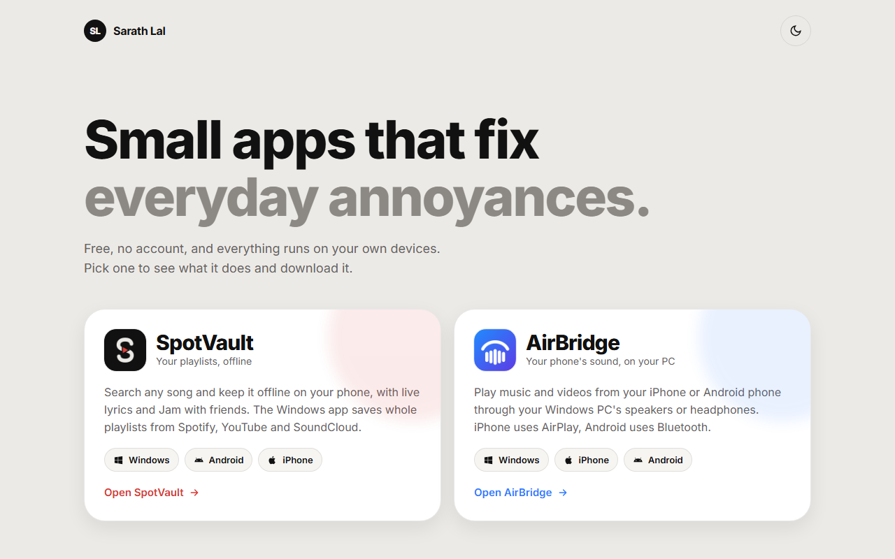

<div align="center">

# Sarath Lal · Apps

**Small, free apps that fix everyday annoyances.**<br>
No accounts, no ads, everything runs on your own devices.

[**sarath-apps.vercel.app**](https://sarath-apps.vercel.app)

<picture>
  <source media="(prefers-color-scheme: dark)" srcset=".github/preview-dark.png">
  
</picture>

</div>

## The apps

| | App | What it does | Platforms | Links |
|---|---|---|---|---|
|  | **SpotVault** | Search any song and keep it offline on your phone, with live lyrics and Jam with friends. The Windows app saves whole playlists from Spotify, YouTube and SoundCloud. | Windows · Android · iPhone | [Website](https://sarath-apps.vercel.app/spotvault/) · [Source](https://github.com/sarathlal-12/spotvault) · [Download](https://github.com/sarathlal-12/spotvault/releases/latest) |
|  | **AirBridge** | Play your phone's sound through your Windows PC's speakers or headphones. iPhone uses AirPlay, Android uses Bluetooth. | Windows · iPhone · Android | [Website](https://sarath-apps.vercel.app/airbridge/) · [Source](https://github.com/sarathlal-12/airbridge) · [Download](https://github.com/sarathlal-12/airbridge/releases/latest) |

## About this site

A hand-written static site: plain HTML and CSS with a little vanilla JavaScript. No framework and no build step.

- Light and dark themes, following your system or the toggle.
- Every app gets its own page, with setup guides, a FAQ and a download section.
- Hosted on [Vercel](https://vercel.com), which deploys each push to `main`.

```
index.html     the home page, one card per app
spotvault/     SpotVault's page
airbridge/     AirBridge's page, with its promo video
j/  pc/        link pages that the SpotVault app opens
api/           SpotVault's AltStore source (/altstore.json)
```

## Run it locally

Any static file server works, for example:

```bash
python -m http.server 8765
```

Then open http://localhost:8765.

## Feedback

Found a problem with an app? Open an issue in that app's repository: [SpotVault](https://github.com/sarathlal-12/spotvault/issues) or [AirBridge](https://github.com/sarathlal-12/airbridge/issues). For the website itself, [open an issue here](https://github.com/sarathlal-12/sarath-apps/issues).

## License

The site's code is [MIT](LICENSE). The app names, logos, screenshots and videos belong to Sarath Lal and aren't covered by the MIT license.

AirPlay and iPhone are trademarks of Apple Inc. Android is a trademark of Google LLC. These apps aren't affiliated with or endorsed by Apple or Google.
